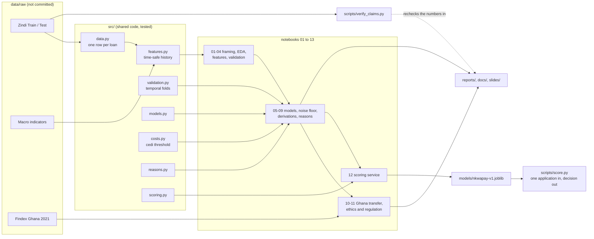

# NkwaPay Credit Scoring (ICS553 Prosit 2)

Default prediction and loan sizing for NkwaPay, trained on Kenyan loans and assessed for transfer to Ghana. Debrief: **Tuesday 3 November 2026**.

> **Want to try the scorer?** `python scripts/score.py examples/application_repeat.json` works straight after `pip install -r requirements.txt`; the saved model is in `models/` and needs no data. To rerun the whole analysis, follow [Running it on your own machine](#running-it-on-your-own-machine).

**Deliverables:** report `reports/NkwaPay_Report_Group3.pdf` (also `.docx`; source `reports/report.md`) · slides `slides/NkwaPay_Debrief_Group3.pptx` (plain-language version `slides/NkwaPay_Debrief_Simple.pptx`) · Model Card `docs/model_card.md` · Datasheet `docs/datasheet.md` · decline letter `docs/decline_letter.md` · AI-use declaration `docs/ai_use_declaration.md` (draft, to sign) · reflection template `docs/reflection_template.md`.

## Headline results

| | |
|---|---|
| Data | 66,520 Kenyan loans after merging co-funded rows, 1.63% default; 2,084 unlabelled Ghana loans |
| Leakage | `Total_Amount_to_Repay` is updated after default (AUC 0.98); dropped. Naive pipeline PR-AUC 0.825 vs honest 0.145 |
| Validation | Temporal expanding window. Random CV overstates 1.7–2.7× and picks the wrong model |
| Regime change | Type_1 (93% of loans) ends 1 Dec 2022; afterwards defaults 9–13%, ROC ~0.6 |
| Classifier | Logistic regression, decline if P(default) > 0.062 (cedi cost matrix). PR-AUC 0.145, ROC 0.725 (temporal) |
| Loan size | Ridge on log amount (repaid loans), median error ~1,930 KES; first-loan cap needed |
| Ghana | 87% unseen products, 96% unseen lenders, domain AUC 1.0. No automated Ghana decisions before a pilot |
| Service | `Scorer.score()` → P(default), approve/decline/refer, 3 reasons, offer; ~20 ms per call. Saved model shipped in `models/nkwapay-v1.joblib` |
| Checked | `make verify` recomputes 50 quoted numbers from the raw files; all 50 reproduce (`reports/claims_table.md`) |

## Where each part of the brief is answered

The brief suggests four notebooks (`01_eda`, `02_classification`, `03_regression`, `04_transfer_and_fairness`). We split the work into one notebook per workplan section instead; this table maps them.

| Brief | Notebooks |
|---|---|
| Part A, framing and cost matrix | `01_problem_framing` |
| `01_eda` (Part B1) | `02_eda` |
| `02_classification` (Part B2 to B7) | `03_features`, `04_validation`, `05_classification`, `07_noise_floor`, `08_derivations`, `09_reason_codes`, `13_rubric_additions` (confusion matrix, approval-rate goal) |
| `03_regression` (Part B4 to B5) | `06_regression`, `08_derivations` |
| `04_transfer_and_fairness` (Parts C and D) | `10_ghana_transfer`, `11_ethics_regulation`, `13_rubric_additions` (PR-AUC and F1 by segment) |
| Part E, scoring service | `12_scoring_service`, `src/scoring.py` |

## Architecture



The raw files are read only through `src/data.py`, which merges co-funded rows into one row per loan. The notebooks import everything that learns from data from `src/`, so the scoring service uses the same feature code as training. `scripts/verify_claims.py` goes back to the raw files and recomputes the numbers quoted in the report on its own.

## Layout

```
data/raw/         raw files (gitignored, see data/README.md)
data/processed/   features and out-of-fold predictions (gitignored, rebuilt by the notebooks)
docs/             Model Card, Datasheet, decline letter, AI declaration, legal texts (BoG Directive, Act 843, Act 726)
examples/         four made-up applications for the scorer: approve, decline, refer (first loan), refer (Ghana)
models/           the saved scoring service, nkwapay-v1.joblib (20 KB; rebuilt by notebook 12)
notebooks/        one notebook per workplan section, 01 to 13
reports/          report, claims table, figures and result tables
scripts/          run_all.sh (everything), verify_claims.py (recheck numbers), score.py (score one application)
slides/           debrief deck and its build script
src/              shared code: data, features, models, validation, costs, bootstrap, reasons, scoring
tests/            31 pytest checks (data, leakage replay, loan merge, reasons, scoring service, shipped model)
```

## Score an application (no data needed)

```bash
pip install -r requirements.txt
python scripts/score.py examples/application_decline.json
```

The file holds one `application` and the applicant's earlier loans as `history`; the fields are listed in notebook 12 and in `src/scoring.py`. The answer is JSON with the default probability, the decision (`approve`, `decline` or `refer`), up to three plain-language reasons and the offered amount. `make score` runs all four examples. The examples are invented; they are not rows from the data.

The saved model holds the fitted coefficients, the preprocessing averages and the threshold. It contains no loan records.

## Running it on your own machine

### 1. Clone and install

```bash
git clone https://github.com/ASU-MICS-2028/mle-group-3-prosit-2.git
cd mle-group-3-prosit-2
python3 -m venv .venv && source .venv/bin/activate     # Windows: .venv\Scripts\activate
pip install -r requirements.txt
```

Python 3.11 or newer (tested on 3.13). The report also needs `pandoc`; the PDF version needs `xelatex` and is skipped if it is not installed.

### 2. Put the data in `data/raw/`

The data is not in this repository because the Zindi and Findex terms do not allow redistribution. `data/README.md` says where each file comes from. The folder must look like this:

```
data/raw/
├── Train.csv                  68,654 rows
├── Test.csv                   18,594 rows
├── economic_indicators.csv
├── VariableDefinitions.txt
└── micro_gha.csv              Findex 2021 Ghana, 1,000 respondents
```

Check it with `make check`.

### 3. Run everything

```bash
make
```

This takes about 15 minutes. It checks the data, runs notebooks 01 to 13 in order, runs the tests, recomputes the quoted numbers and rebuilds the report and slides. Without `make`: `bash scripts/run_all.sh`.

| Command | What it does |
|---|---|
| `make check` | confirms the raw files are present with the expected shapes |
| `make test` | runs the 31 tests |
| `make verify` | recomputes 50 quoted numbers from the raw files (about 10 seconds) |
| `make report` | rebuilds the report from `reports/report.md` |
| `make slides` | rebuilds the debrief deck |
| `make score` | scores the example applications |

Notebooks depend on each other's saved outputs: 03 writes `data/processed/features.pkl`, 05 and 06 write out-of-fold predictions used by 07. Run them in order (the script does).

On macOS LightGBM is pinned to one thread (`n_jobs=1`); multithreaded fits were about 40× slower here.

### If something fails

| Message | What to do |
|---|---|
| `Missing Train.csv; see data/README.md` | A file from step 2 is missing or misnamed in `data/raw/`. |
| `assert df.shape == shape` in `test_data_present` | You have a different version of the Zindi or Findex file. |
| `ModuleNotFoundError` | Activate the environment from step 1 and reinstall the requirements. |
| `FileNotFoundError: ... features.pkl` | A notebook was run out of order. Run `make`, or run 03 first. |
| `Saved model not found` | Run `notebooks/12_scoring_service.ipynb`, which trains and saves it. |
| `MISMATCH` from `make verify` | A quoted number no longer matches the data. Fix the text or the code before submitting. |

## Known data issues

Found while doing the analysis; each is documented in `docs/datasheet.md` or the notebook named.

1. **`Total_Amount_to_Repay` records the outcome.** It is updated with penalties after a default, so on identical contracts repaid loans owe 0.7% over principal and defaulted loans 41%. It and `Lender_portion_to_be_repaid` are dropped (`01_problem_framing`).
2. **One loan can be two rows.** 2,134 Train loans are co-funded and appear once per lender. The brief's 1.83% default rate is per row; per loan it is 1.63% (`02_eda`).
3. **Zindi split Train and Test by row.** For 920 loans one lender's row is in Train with its label and the other is in Test. We did not use this.
4. **The default rule is not stated.** The data says only 1 = defaulted, with no days-past-due or grace period. We treat the outcome as known at the due date.
5. **Only approved loans are in the data.** Declined applications do not appear, so the model learns from borrowers a past policy already accepted.
6. **The market changed on 1 December 2022.** Type_1 (93% of loans) stops; afterwards defaults run at 9 to 13% and every model is weaker (`04_validation`).
7. **Ghana has no labels and little overlap.** 87% of Ghana loans are on products never seen in Kenya and 96% on unseen lenders. Ghanaian borrowers' earlier loans are all unlabelled Test loans, so they look as if they have no repayment record (`10_ghana_transfer`).
8. **Amounts are in local currency.** Kenyan shillings and Ghanaian cedis are not comparable without conversion.
9. **The macro indicators carry almost no information.** They take four distinct values within Kenya and act as a year label. Zindi calls them FRED series but the codes are World Bank codes (`03_features`).
10. **There is no gender, age or location column.** Fairness is checked on product, lender, tenure and loan size, and the Findex survey is used for gender, income and rural gaps (`11_ethics_regulation`).

## Conventions

- Notebooks are named `NN_topic.ipynb` to match the workplan sections.
- Shared logic goes in `src/` with a test, not in notebooks.
- Branch per section (`section/03-features`), merge into `main`.
- `random_state=SEED` (42) everywhere; call `set_seed()` at the top of each notebook.

## Progress tracker

| Section | Owner | Status | Notebook / output |
|---|---|---|---|
| 0 Setup | | Done | repo, `requirements.txt`, `tests/test_data_present.py` |
| 1 Framing (Part A) | | Done | `01_problem_framing.ipynb`, `src/schema.py`, `src/costs.py` |
| 2 EDA (B1) | | Done | `02_eda.ipynb`, `src/data.py` |
| 3 Features (B2) | | Done | `03_features.ipynb`, `src/features.py`, `tests/test_features.py` |
| 4 Validation (B3) | | Done | `04_validation.ipynb`, `src/validation.py` |
| 5 Classification (B4–B5) | | Done | `05_classification.ipynb`, `src/models.py` |
| 6 Regression (B4–B5) | | Done | `06_regression.ipynb` |
| 7 Noise floor (B6) | | Done | `07_noise_floor.ipynb`, `src/bootstrap.py` |
| 8 Derivations (LO3) | | Done | `08_derivations.ipynb` |
| 9 Reason codes (B7) | | Done | `09_reason_codes.ipynb`, `src/reasons.py` |
| 10 Ghana transfer (Part C) | | Done | `10_ghana_transfer.ipynb` |
| 11 Ethics and regulation (Part D) | | Done | `11_ethics_regulation.ipynb`, `docs/model_card.md`, `docs/decline_letter.md` |
| 12 Scoring service (Part E) | | Done | `12_scoring_service.ipynb`, `src/scoring.py` |
| 13 Report, slides, AI declaration | | Drafted, team review needed | `reports/`, `slides/`, `docs/ai_use_declaration.md` |
| Rubric additions | | Done | `13_rubric_additions.ipynb` (confusion matrix, approval-rate goal, PR-AUC/F1 by segment, ±0.0263 noise floor), `docs/datasheet.md` |
| Submission checks | | Done | `scripts/verify_claims.py`, `reports/claims_table.md`, `Makefile`, shipped model and `scripts/score.py`, Act 726 mapped from its text |
| 14 Individual reflection | everyone | To do | `docs/reflection_template.md` |

## Open items for the team

1. Fill in owners above and sign the AI-use declaration.
2. Agree or change the cost-matrix assumptions (`src/costs.py`) and the regression target (repaid loans only).
3. Everyone: rerun `make` and be able to explain each number.
4. Write individual reflections.

Closed: Act 726 was read from the Parliament of Ghana's copy (`docs/legal/Act726_CreditReportingAct2007.pdf`). The bureau-search duty is section 26(4); the full mapping is in `11_ethics_regulation.ipynb` §11.4. Amendments after 2012 and the Borrowers and Lenders Act 2020 are still not reviewed.
