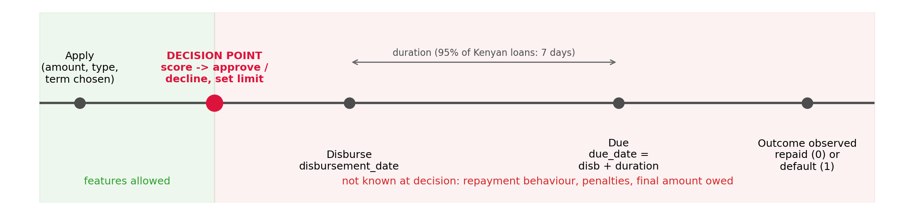
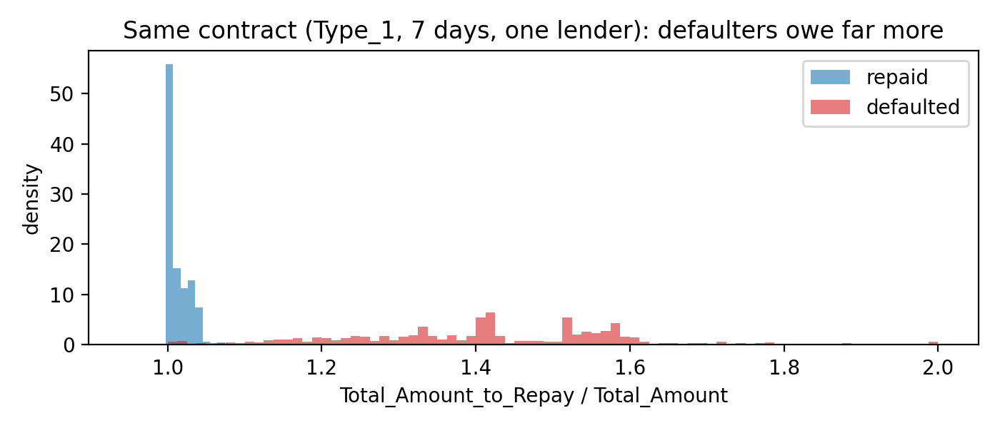
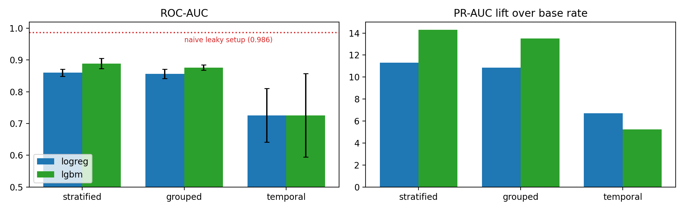
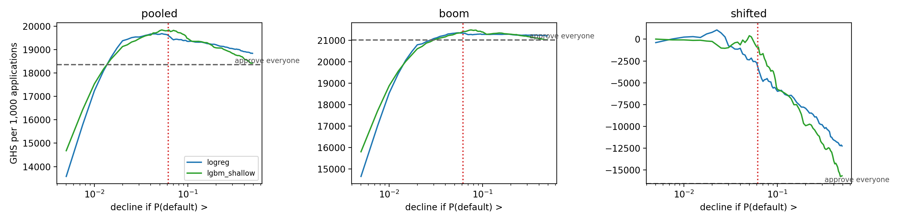
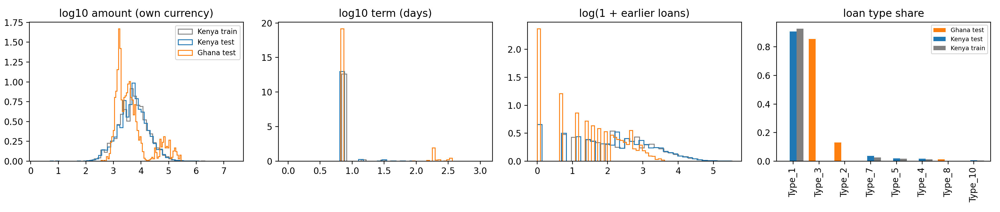

# 1. Summary

NkwaPay wants to score digital loan applications in Ghana using a model trained on Kenyan loans. We built two models from 66,520 labelled Kenyan loans: a classifier that estimates the probability of default, and a regression that suggests how much to lend. We then asked whether either can be trusted in Ghana.

The main findings:

- **The raw data invites a misleading model.** `Total_Amount_to_Repay` is updated after a loan defaults (penalties), so it predicts default almost perfectly (AUC 0.98). A naive pipeline that uses it scores PR-AUC 0.825; our honest out-of-time estimate is 0.145.
- **Validation design changes the answer.** Random cross-validation overstates performance and picks the wrong model: LightGBM wins under stratified CV but loses to logistic regression on future loans.
- **The Kenyan market changed in December 2022.** Type_1, the dominant low-risk product (93% of loans), stops after 1 December 2022. Afterwards defaults run at 9 to 13% and both models fall to ROC about 0.6.
- **The chosen model** is unweighted logistic regression with a decline threshold of P(default) > 0.062, derived from a cedi cost matrix. It beats approving everyone on every metric; it cannot be separated from shallow LightGBM on PR-AUC overall, but it ranks significantly better after December 2022 and gives exact reason codes.
- **Ghana is out of reach for now.** 87% of Ghana loans are on products never seen in Kenya and 96% on unseen lenders; a classifier separates Ghana from Kenya with AUC 1.0. We recommend no automated Ghana decisions until pilot outcomes exist.

All results are reproducible from the repository (`scripts/run_all.sh`).

# 2. Problem framing (Part A)

**Decision point.** The model runs at approval: the applicant has chosen product, amount and term, and nothing has been disbursed (Figure 1). Any value set after that moment cannot be a feature.

{width=95%}

**Label.** `target = 1` means the loan defaulted. The data does not state the default rule (days past due or grace period); we treat outcomes as known at the due date and flag this for NkwaPay.

**Feature audit.** Every column was classified as usable, identifier, redundant or leaky (`reports/01_feature_audit.csv`). Two decisions needed evidence. `due_date` equals `disbursement_date + duration` on every row, and `Amount_Funded_By_Lender` equals share times amount, so both are redundant. `Total_Amount_to_Repay` looks like a contract term but is not: on the same product, term and lender, repaid loans owe about 0.7% over principal and defaulted loans about 41% (Figure 2). We dropped it and the column derived from it.

{width=75%}

**Two tasks.** Task 2 (classification) predicts default and is scored with PR-AUC, because only 1.63% of loans default. Task 1 (regression) predicts `log(1 + amount)` on repaid loans only, so it learns what borrowers like this have shown they can repay rather than copying past lending decisions, including the ones that defaulted.

**Cost matrix.** For a representative GHS 500 loan with an 8% flat fee, 2% funding cost, GHS 5 operating cost, GHS 15 collection cost and 30% recovery, approving a repayer earns G = GHS 25 and approving a defaulter loses L = GHS 380. Declining is worth zero, so the expected value of approving is positive when P(default) < G / (G + L) = 0.062. One default wipes out the profit of about 15 good loans. The threshold moves from 4.5% with no recovery to 16% at 80% recovery, and pricing matters even more: below a 3% fee no loan is profitable. All figures are our assumptions (`src/costs.py`); the BoG Directive requires disclosed, non-compounded interest but sets no cap.

# 3. Data and preprocessing (Part B1)

**Loan-level data.** 2,134 loans are co-funded by two lenders and appear on two rows with identical loan details. We merged them into one row per loan with an `n_lenders` feature. At row level the default rate looks like 1.83%; per loan it is 1.63%, because co-funded loans default far more often (8.3% against 1.4%) and were counted twice. Zindi split the competition data by row, so for 920 loans one half is in Train with its label and the other half is in Test. We did not exploit this.

**Distributions.** No values are missing. Amounts range from 2 to 23 million KES, so we use a log scale. 96% of loans are 7-day loans, and longer terms default much more often (52% above 90 days). 22 product types exist; Type_1 is 93% of loans and 11 types have fewer than 30 loans, so rare types are grouped as `Other` and unseen ones as `Unknown` inside each training fold.

**Customer overlap.** 87% of Test customers also appear in Train (all Kenyan); every Ghanaian customer is new. Customers have a median of 6 loans. We therefore never let a customer's loans sit on both sides of a validation split by accident, and we treat a customer's earlier loans as legitimate history.

# 4. Features (Part B2)

All features live in `src/features.py` and are shared by training and the scoring service.

- **Loan terms:** log amount, term, amount per day, lender share, number of co-funders, New/Repeat.
- **Borrower history (14 features):** counts of earlier loans, resolved loans and defaults, smoothed past default rate, active loans and amounts, time since the last loan and the last default, past amounts and terms, distinct lenders.
- **Calendar and macro** features were built and later removed (below).

The timing rules are strict. History counts only loans disbursed on an earlier date, and a past outcome counts only once its due date has passed. Macro indicators for year Y join loans from Y + 1. A replay test rebuilds the data as it stood on five decision dates and checks that every feature is unchanged; a second test flips all future labels. We injected two leaks by hand to confirm the tests catch them, one of which was a real bug in our first draft (a smoothing prior computed over all labels).

Two findings shaped the model. Only 89 loans have an observable earlier default, because 95% of defaulters never borrow again; the useful history signal is how much and how often someone borrows (6.3% default with no earlier loan, 0.2% after 25 or more). The macro block takes only four distinct values within Kenya, so it can only act as a year label, and Ghana's inflation (up to 31%) lies far outside Kenya's range. It added nothing out of time (at most 0.003 PR-AUC) and was dropped.

# 5. Validation design (Part B3)

We scored logistic regression and LightGBM under three schemes (Table 1). The temporal scheme trains only on loans whose outcome was known before each cut-off and tests on the following window (cut-offs 1 Sep, 1 Oct, 1 Nov and 1 Dec 2022, and 1 Jan 2024).

| Scheme | LogReg PR-AUC | LogReg ROC | LightGBM PR-AUC | LightGBM ROC |
|---|---|---|---|---|
| Stratified 5-fold | 0.184 | 0.860 | **0.233** | 0.889 |
| Grouped by customer | 0.178 | 0.856 | 0.220 | 0.876 |
| Temporal (5 folds) | **0.129** | 0.726 | 0.106 | 0.726 |
| *Naive: row level, leaky columns, random* | | | *0.825* | *0.986* |

: Table 1. The same models under different validation schemes.

{width=90%}

Grouping by customer barely matters (3 to 6% in PR-AUC) because the history features are leakage-safe. Time is what matters: adjusted for each fold's base rate, stratified CV overstates performance 1.7 times for logistic regression and 2.7 times for LightGBM, and it **reverses the ranking of the two models**. In the 2022 folds the models reach ROC about 0.8; from December 2022, when Type_1 disappears, defaults jump and ROC falls to about 0.6. Repeat customers are scored badly in that period too, so the cause is a market change rather than missing history. We used the temporal scheme for everything that follows.

# 6. Models (Parts B4 to B6)

**Classification.** We compared 12 candidates on the temporal folds: a baseline that predicts the training default rate, four logistic regressions (unweighted, class-weighted, undersampled, stronger regularisation), a decision tree, a random forest (each with and without class weights) and three LightGBM variants. Unweighted logistic regression had the best PR-AUC (0.143) and the best lift after December 2022 (1.81). Shallow LightGBM had the best ROC (0.741). The default LightGBM and the forest fitted the 2022 boom closely and degraded most later. Class weighting did not improve ranking for any model family and destroyed calibration: weighted logistic regression predicts an average default probability of 0.29 against an actual 0.016, which would make a cost threshold meaningless.

**Value in cedis.** Per 1,000 applications, approving everyone earns about GHS 21,000 in the 2022 regime and loses about GHS 16,600 after December 2022. Logistic regression at 0.062 adds little in 2022 (+300) but cuts the later loss to about 3,500. A credit model matters most exactly where it is least accurate.

{width=95%}

**Calibration.** Probabilities are well calibrated in the 2022 regime. After December 2022 the average is right (10.8% predicted, 10.3% observed) but the spread is too wide: loans scored at 1 to 5% default at 5 to 10%, and loans scored above 50% default at about 22%. The fix is monthly recalibration (Platt scaling) on recent outcomes.

**Operating point.** Logistic regression, decline when P(default) > 0.062. In 2022 this declines 1% of applicants and catches 15% of defaults; after December 2022 it declines 36% and catches 53%. Pooled F1 is 0.20.

**Regression.** Ridge regression (with terms on a log scale and predictions capped at the largest amount ever repaid) was jointly best on log RMSE (0.759) and best on MAE in KES (about 5,900; median error about 1,930 KES or GHS 150). On a raw scale a linear model extrapolated three-year loans to e^57 KES, a useful lesson in why transforms matter. A simple rule, "lend what this borrower borrowed on average before", lands within 25% of the actual amount more often than any model (38%). First-time borrowers are over-predicted by about 40%, so a first-loan cap is needed.

**Noise floor.** A paired bootstrap that resamples customers (1,000 replicates) gives the following results. Logistic regression beats the baseline on every metric in every replicate. Against shallow LightGBM, PR-AUC and F1 are not distinguishable overall; LightGBM is significantly better on ROC (by 0.024) and earns slightly more at the threshold (about GHS 250 per 1,000). After December 2022, logistic regression is significantly better on PR-AUC (+0.038, interval 0.008 to 0.070). The bootstrap also exposed a trap: pooling out-of-fold scores across folds inflates ranking metrics (a constant baseline scores ROC 0.44), so ranking metrics are computed within folds and averaged. We kept logistic regression for its transparency and its edge in the period most like Ghana, and do not claim it is more accurate overall.

# 7. Derivations (LO3)

The notebook derives the log-loss, gradient $\frac{1}{n}X^\top(p - y)$ and Hessian $\frac{1}{n}X^\top W X$ of logistic regression and shows that the loss is convex. It derives the normal equation $\hat\beta = (X^\top X)^{-1}X^\top y$ and the ridge solution, and gradient boosting with log-loss (pseudo-residuals $y - p$, Newton leaf values $\sum(y-p) / (\sum p(1-p) + \lambda)$). Each is checked on our data: our Newton solver matches scikit-learn to five decimals. Two results connect to the models. The full regression design is rank-deficient (rank 35 of 40 columns), so ridge is needed for a unique solution. And a full Newton boosting step diverges with rare defaults because the curvature $p(1-p)$ is tiny, which is why boosting needs a learning rate.

# 8. Interpretation and reason codes (Part B7)

For a linear model the log-odds split exactly into one contribution per input relative to the average applicant. We sum these into reason families and report the three that push hardest towards decline, in plain language. A test confirms the contributions reproduce the model's probabilities.

Two corrections came out of this. `log_amount` (+1.65) and `amount_per_day_log` (−1.56) nearly cancel and together mostly encode the term, so a "loan too large" reason would have pointed the wrong way; term and amount now form one family. And Ghanaian applicants on unseen products were about to be told their product "had repayment problems", when the model has no record of it at all; they now receive "This product type is new to us, so we have no repayment record for it yet". Calendar features moved individual scores without predicting anything, so the deployed model drops them (PR-AUC 0.1428 to 0.1449, within noise).

# 9. Kenya to Ghana (Part C)

{width=100%}

Ghanaian applications differ on almost every axis: 87% are on products never seen in Kenya, 96% on unseen lenders, 66% are co-funded (3% in Kenya), 14% run longer than 30 days (1% in Kenya), and 21% of borrowers have no earlier loan. A domain classifier separates the countries with AUC 1.000, and still 0.999 without product, lender and co-funding. Part of this is an artefact: Ghanaian borrowers' earlier loans are all unlabelled Test loans, so they look as if they have no repayment record, which would not be true in production.

Importance weighting collapses: the effective sample falls to 1,515 of 66,520 loans (2.3%), and the top 1% of Kenyan loans carry half the weight. The weighted model's Ghana scores correlate only 0.58 with the unweighted ones, and with no Ghanaian outcomes we cannot tell which is better. Applied to Ghana, the model would decline 22% of applicants (Kenya 6.7%): almost every Type_2 and Type_8 loan, but only 8.5% of Type_3, which is 86% of Ghana volume. These are extrapolations, not risk estimates.

Before trusting Ghana scores NkwaPay needs: outcomes from a capped pilot; recalibration and out-of-time validation on those outcomes; definitions of the new products and lenders; full Ghanaian repayment histories; currency-consistent amounts; credit-bureau data; fairness checks on pilot outcomes; and live drift monitoring.

# 10. Ethics and regulation (Part D)

**Segments.** The largest gaps are by borrowing history. Applicants with no earlier loan default at 11% (0.3% for 20+ loans) and are declined 32% of the time, including 30% of those who would have repaid. Decline rates differ by an order of magnitude between lenders and products; the model almost never declines Type_1.

**Proxies.** The data holds no protected attributes, so we tested proxies. Borrowing history is the strongest candidate. Removing all six history features changed almost nothing (PR-AUC 0.145 to 0.144; good thin-file borrowers still declined 27% of the time), because missing past amounts and the lack of any repayment record identify the same people. Dropping a proxy does not remove it. Our mitigation is a policy: no automatic decline for applicants without a repayment record, a capped starter loan instead, monthly parity monitoring by history band, and a consented demographic sample kept apart from scoring for audits.

**Findex 2021 Ghana (survey-weighted).** 60% of adults have a mobile money account, but only 7% borrowed from a formal institution in the past year, while 52% borrowed some money. Account ownership is clearly lower for women (63% against 74%), the poorest 40% (55% against 77%), the least educated and rural adults (57% against 76%). Mobile-money borrowing is not lower for these groups. Digital credit already reaches them, and they arrive with thin formal records, which is exactly the profile the model penalises.

**Regulation.** From the documents we read: the BoG Digital Credit Directive (2025) requires clear disclosure (§6.1, §7.1), complaint resolution within 20 days (§6.1(e)), no harassment in collection (§7.2) and daily, consented reporting to credit bureaus (§7.3). The Data Protection Act 2012 (Act 843) requires minimality (s.19), a lawful basis (s.20), data quality (s.26), access and correction (s.32 to 33) and no processing of special personal data (s.37). Section 41 gives a right to notice and reconsideration within 21 days for decisions taken solely by automated means; s.41(4) exempts decisions about entering a contract, which may cover credit, but we design as if it applies. We could not obtain the text of the Credit Reporting Act 2007 (Act 726); it reportedly requires a credit report before lending, which our system does not do. What we cannot meet with the model alone: bureau checks and reporting, Ghana-specific accuracy, group fairness against protected traits, and organisational duties such as registration and breach notification.

The Model Card is in `docs/model_card.md`, and an example decline letter, which offers human review within 21 days, data access and correction, and a 20-day complaint route, is in `docs/decline_letter.md`.

# 11. Scoring service (Part E)

`Scorer.score(application, history)` returns the default probability, a decision, the top three reasons and an offered amount. It uses the same feature code as training; a test shows it rebuilds identical features for random Train loans. The policy has three outcomes: **approve** (offer the smaller of the request and the predicted limit, capped for first loans), **decline** (above the threshold, with a repayment record), and **refer** (thin-file applicants above the threshold, and any market other than Kenya). A call takes about 20 ms (p95 32 ms), and batch scoring runs at about 115,000 loans per second. The app sends nine application fields and the applicant's earlier loans with outcomes; no personal or sensitive attributes are needed.

# 12. Limitations and next steps

The cost matrix uses our own figures. The default rule and the timing of `Lender_portion_Funded` need confirming with NkwaPay. Act 726 and the Borrowers and Lenders Act 2020 were not reviewed from their texts. The Kenyan model already struggles after the December 2022 change, and Ghana is further still from its training data. The next step is not a better Kenyan model but Ghanaian outcomes: a small, capped, monitored pilot with human review, followed by recalibration and a Ghana-specific validation.
